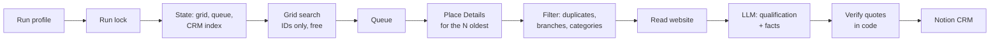

# B2B Lead Generation on n8n

A prospecting pipeline for a sales team that cold-calls small businesses
in Portugal. Pick a run profile (who gets the leads, which niche, which
towns) and it finds businesses on Google Maps, drops duplicates before
spending anything, reads each company's website, has an LLM qualify the
lead, and writes it to a Notion CRM, ready to call. For an email
outreach system, it also extracts facts about each company, each one
backed by an exact sentence from the company's own website that I
verify in code.

I built it as code, not by hand in the n8n editor: one source file per
node, a builder that assembles and deploys the workflow, a test bench
that runs every node outside n8n, and a development copy wired to a
test CRM so production is never edited in place.

---

## At a glance

| | |
|---|---|
| Distinct businesses per area | **87**, up from the same **20** on every re-run |
| Duplicates written to the CRM | **0** (re-running a search creates nothing new) |
| Search cost | **$0**: ID-only search, paid details only for what's selected |
| Facts checked against the website | **84%** of the facts the model proposed were found on the site (93 of 111); the rest never reach the CRM |
| AI cost | ~**$0.02** per lead with a website, ~**$0.0015** without one |
| Tests | **279** checks, no network, no keys |
| Workflow | **65** nodes, generated from 24 node source files and a profile file |

## What it does

- **Searches by grid, not by query.** Google's text search stops at 60
  results and in practice returns the same top 20. The workflow splits
  each town into a grid, subdivides dense cells, and keeps a queue of
  every business found, so each run picks up where the last one stopped.
- **Pays only for what's new.** Searching for IDs is free; details, the
  website read and the AI call only run for businesses that aren't
  already in the CRM, aren't closed, and aren't in an excluded Google
  category.
- **Qualifies with a closed format.** The LLM answers in a JSON schema:
  in-niche or not, a sub-niche from a fixed list, a 1–10 score against a
  per-niche rubric, and short signals. Each signal names its source and
  is dropped if the source doesn't hold up.
- **Verifies facts for email.** Every fact comes with the website
  sentence that proves it. Code finds that sentence in the text sent to
  the model, after normalizing both sides the same way, and drops facts
  that aren't there, that name a person, or that are just contact
  details. Only what passed is written, in a JSON block in the CRM page,
  together with proof that the business is a company when the site
  shows one (a company form next to its name, or a valid company tax
  number), which the outreach needs for its legal-basis rule.
- **Runs from profiles.** Each profile holds the owner, niche, search
  terms, scoring rubric and a list of towns; runs rotate through the
  towns on their own. It runs from a form in the editor or on a weekday
  schedule, one run at a time per CRM.
- **Fails safe.** If the CRM can't be read, nothing is written. A lead
  that fails stays in the queue for the next run. Expected errors
  release the run lock before stopping.

## Architecture



## Documentation

The full case study is in [docs/CASE-STUDY.md](docs/CASE-STUDY.md):

- [the problem and the results](docs/CASE-STUDY.md#1-the-problem);
- [how it evolved](docs/CASE-STUDY.md#4-evolution) from a linear pipeline to the current design;
- [every stage of the pipeline](docs/CASE-STUDY.md#5-the-pipeline-stage-by-stage);
- [the AI layer](docs/CASE-STUDY.md#6-the-ai-layer) and [the verified facts](docs/CASE-STUDY.md#13-verified-facts-for-email-outreach);
- [engineering decisions](docs/CASE-STUDY.md#8-engineering-decisions): idempotency, fail-closed reads, the run lock;
- [onboarding a second niche](docs/CASE-STUDY.md#11-case-study-onboarding-a-second-niche), measured round by round;
- [costs](docs/CASE-STUDY.md#14-costs), [limitations](docs/CASE-STUDY.md#15-limitations-and-next-steps) and [lessons](docs/CASE-STUDY.md#16-lessons-learned).

Search terms, CRM fields, node names, prompts and code comments are in
European Portuguese, because the businesses and the sales team are in
Portugal. Every identifier in this repository is a placeholder, and the
businesses in the tests are fictional.

## Repository and setup

```
lead-gen/
  perfis.json            run profiles (owner, niche, terms, rubric, localities)
  00-comum.js            shared functions, prepended to nodes marked // @comum
  *.js                   one file per Code node
build-lead-gen.js        builds the workflow JSON; --enviar <id> deploys it; --dev builds the test copy
validar-perfis.js        rejects a broken perfis.json at build time
testar-lead-gen.js       test bench: 279 checks, no network, no credentials
docs/CASE-STUDY.md       the full case study
```

```bash
node testar-lead-gen.js        # run the test bench
node build-lead-gen.js         # writes lead-gen.json, ready to import into n8n
```

To run it on your own n8n instance:

1. **Credentials** in n8n: Google Places (header auth, `X-Goog-Api-Key`),
   OpenRouter, and Notion (header auth, `Authorization: Bearer …`).
2. **Data Tables** in n8n:
   - `leadgen_celulas`: chave, crm, nicho, cidade, termo, sul, oeste,
     norte, este, nivel, estado, resultados, novos, atualizada;
   - `leadgen_places`: place_id, crm, nicho, cidade, termo, estado,
     motivo, nome, atualizado;
   - `leadgen_lock`: chave, execucao, desde.
3. **A Notion database** with the properties listed in the
   [data model](docs/CASE-STUDY.md#7-data-model), and a copy of it for tests.
4. **Placeholders** at the top of `build-lead-gen.js`: the credential
   IDs, the three Data Table IDs, and the two Notion database IDs
   (`aaaa…` for production, `bbbb…` for tests).
5. **Profiles** in `lead-gen/perfis.json`: owners, niches, terms and
   localities.

Then `node build-lead-gen.js --enviar <workflow-id>` deploys through the
n8n API (`N8N_API_URL` and `N8N_API_KEY` in the environment), or import
`lead-gen.json` by hand.

## License

Shared for portfolio purposes only. All rights reserved; see [LICENSE](LICENSE).
