# Automated B2B Prospecting with n8n, Google Places and Claude

> A lead generation pipeline that finds businesses in a given niche and
> area, removes duplicates before spending any money, reads each
> company's website, asks a language model for a structured
> qualification, and delivers everything to a Notion CRM, ready for the
> sales team to call. It also extracts facts about each company, each
> one backed by a sentence from the company's own website that I verify
> in code, for an email outreach system to write from.

| | |
|---|---|
| **Platform** | n8n (self-hosted), 65 nodes |
| **Data sources** | Google Places API (New): Text Search and Place Details |
| **Enrichment** | Website scraping (HTTP + Jina Reader for JavaScript-rendered pages) |
| **AI** | Claude Sonnet 5 through OpenRouter, JSON schema output, quotes verified in code |
| **Destination** | Notion (CRM), via REST API: properties for the sales team, a JSON block in the page body for email outreach |
| **Persistent state** | n8n Data Tables (search grid, Place ID registry, run lock) |
| **Operation** | Named run profiles (owner, niche, localities), a form run from the n8n editor, and a weekday schedule |
| **Engineering** | Workflow-as-code in Node.js, test bench with 279 checks, a development copy wired to a test CRM, deploy and export through the n8n API, version history in Git |

> **Context:** I built this for an automation agency in Portugal. Search
> terms, CRM fields, node names, prompts and code comments are in
> European Portuguese. Translations are given where they matter.

---

## Contents

1. [The problem](#1-the-problem)
2. [Results](#2-results)
3. [Architecture](#3-architecture)
4. [Evolution](#4-evolution)
5. [The pipeline, stage by stage](#5-the-pipeline-stage-by-stage)
6. [The AI layer](#6-the-ai-layer)
7. [Data model](#7-data-model)
8. [Engineering decisions](#8-engineering-decisions)
9. [Workflow-as-code: build, test, deploy](#9-workflow-as-code-build-test-deploy)
10. [Per-niche configuration](#10-per-niche-configuration)
11. [Case study: onboarding a second niche](#11-case-study-onboarding-a-second-niche)
12. [Run profiles and scheduling](#12-run-profiles-and-scheduling)
13. [Verified facts for email outreach](#13-verified-facts-for-email-outreach)
14. [Costs](#14-costs)
15. [Limitations and next steps](#15-limitations-and-next-steps)
16. [Lessons learned](#16-lessons-learned)

---

## 1. The problem

An automation agency sells to small and mid-sized businesses in specific
niches: aesthetic clinics, HVAC companies, and others. The sales team
works through cold calls and needs:

- **volume**: dozens of new businesses per week, per niche and per area;
- **quality**: a phone number, website, email and a reason to call each one;
- **zero duplicates**: a rep who calls the same company twice burns the contact;
- **controlled cost**: Google searches and AI model calls are billed per request.

Doing this by hand in Google Maps takes hours and produces a spreadsheet
with no criteria. My goal was to turn "find clients" into a button:
pick the niche and the area, hit *Execute*, and find 20 new, qualified,
ready-to-call businesses in the CRM.

---

## 2. Results

| Metric | Before (v2) | After (v3) |
|---|---|---|
| Distinct businesses per area (test run, one mid-sized city) | 20, always the same ones | **87** |
| AI responses lost to truncation (`max_tokens`) | 25–35% of leads per run | **0** (detected and flagged for re-analysis) |
| Duplicates created in the CRM by error | yes (the same lead 3×) | **0** (verified on re-run: 20 rows, 20 Place IDs) |
| AI analysis paid for businesses already in the CRM | yes (dedup at the end) | **no** (dedup before enrichment) |
| Cost of the Google search step | paid per result | **free** (ID-only search) |
| Re-running the same search | returned the same 20 businesses | moves on to new cells; warns when the area is exhausted |

One production run in a large city, in the clinics niche:

- 20 grid cells searched, 44 search requests (free);
- **808 Place IDs** found, 333 already known, **475 new** saved to the queue;
- 11 cells automatically subdivided because they were saturated;
- 20 detail requests (paid, only for the selected ones), **20 leads created**, 0 failed;
- 2 branch locations detected and flagged (not dropped);
- 14 of the 20 had their own website analyzed by the AI.

The remaining 455 IDs stay queued: the next runs in that city don't need
to search again.

A second niche (HVAC) needed more tuning: written leads in the niche went
from 40% to 100% after the fixes in [section 11](#11-case-study-onboarding-a-second-niche).

---

## 3. Architecture

```mermaid
flowchart LR
    T[Form · Manual · Schedule] --> PR[Run profile<br/>perfis.json]
    PR --> LK[Run lock]
    LK --> B[State<br/>Data Tables + CRM]
    B --> LC[Pick locality<br/>rotation]
    LC --> C{New term<br/>for this area?}
    C -- yes --> D[Area bounds<br/>+ minimum area]
    D --> E[N×N grid]
    C -- no --> F
    E --> F[Plan:<br/>cells to search]
    F --> G[ID-only search<br/>up to 3 pages per cell]
    G --> H[Close search:<br/>queue + subdivision]
    H --> I[Pick from queue<br/>N oldest]
    I --> J[Place Details]
    J --> K[Filter new<br/>dedup + branches]
    K --> W{Has website?}
    W -- yes --> M[Read site<br/>+ 2nd read]
    W -- no --> N
    M --> N{Enough text?}
    N -- yes --> O[Claude:<br/>qualification + facts]
    O --> V[Verify quotes<br/>in code]
    N -- no --> P
    V --> P[Prepare Notion]
    P --> Q[Create CRM page<br/>+ facts block]
    Q --> R[Summary + final state<br/>+ release lock]
```



Expected errors after the lock (no locality left, Notion down, an
unknown locality) take a separate branch that releases the lock before
the run stops.

Guiding principle: **every paid step only runs for whatever made it that
far.** Search is free and broad. Details are paid and only for the N
selected. Website reading and AI only run for leads that passed the
duplicate filter. Notion only receives what passed the niche filter.

---

## 4. Evolution

### v1 and v2: the linear pipeline

My first version was the "natural" n8n lead gen design:

```
Text Search → Split Out → (optional AI) → Merge → Notion: exists? → Create
```

v2 moved to the Places API (New) and added homepage reading before the
AI step. It worked, but when I audited the CRM, about 200 leads and 11
runs, exposed structural problems:

| Symptom in the CRM | Root cause |
|---|---|
| ~32 leads with "Error parsing AI response" | Response cut off by `max_tokens: 700`; the JSON arrived broken |
| Same lead created 3 times | A 126-character email → Notion returns 400 → `retryOnFail` re-sent the whole batch, including the items already created |
| "Websites" that were Facebook, Instagram or booking platforms | Google returns the listing's link as-is |
| ~18 real sites flagged "not analyzable" | JavaScript-rendered sites: the initial HTML is empty |
| Branches of the same brand as independent leads | Different Place IDs, same domain or phone |
| Re-running yielded 2 or 3 new leads | Text Search always returns the ~20 most relevant businesses |
| AI paid for businesses already in the CRM | The duplicate check was the last step |

### v3: a two-phase rewrite

**Phase 1, correct pipeline and clean data:**
dedup before enrichment, social-network detection, second read for
JavaScript sites, email and phone validation, truncation-proof AI
output, and Notion writes without unsafe retries.

**Phase 2, volume:**
a geographic grid with automatic subdivision, ID-only search (free), a
persistent ID queue, a registry of everything already seen, and a
target number of leads per run.

My working rule throughout the rewrite: I never edited the production
version directly. I built each change in a copy, tested it against a
Notion test table, and only then swapped it in for the original.

### After v3: operation and a second consumer

With the pipeline stable, the next changes came from how it was used:

- **Run profiles** replaced the hand-edited Config, with a rotation
  through each profile's localities, a form run from the editor, a run
  lock and a weekday schedule ([section 12](#12-run-profiles-and-scheduling));
- **verified facts** for an email outreach system, extracted in the same
  AI call and checked in code against the website text
  ([section 13](#13-verified-facts-for-email-outreach));
- a **minimum search area**, after finding that Google reduces some
  municipalities to their town center ([5.3](#53-area-grid)).

The same rule held: every change went through a development copy wired
to a test CRM before reaching production.

---

## 5. The pipeline, stage by stage

### 5.1 Profile and validation

A run starts from a named profile (see
[section 12](#12-run-profiles-and-scheduling)). The `Perfil escolhido`
("chosen profile") node merges the profile with the run options, and
`Config base` validates and normalizes everything **before a single
request is spent**:

- the profile must exist, and a requested locality must belong to it;
- `notion_db` must be a 32-character hex ID (hyphens accepted);
- `nicho` (niche) and at least one locality are required;
- `termos` (search terms) split on `;` or newlines, lowercased and deduplicated;
- `sub_nichos` (sub-niches) as a closed list, with `Outro` ("Other") always appended;
- bounded numbers (`leads_novos_desejados` 1–100, `max_pedidos_google` 3–300, `grelha` 1–5);
- `criterios_score` (scoring criteria) up to 1,500 characters.

An error here stops the run with a readable message, e.g. "missing
location (e.g., Guimarães, Portugal)". These checks run before the run
lock is taken, so a typo never leaves the lock held.

After the state reads, `Config ativa` ("active config") picks the
locality: the one requested, or the first in the profile that still has
work.

### 5.2 State: the CRM index

Three reads, each executed once per run (`executeOnce`):

1. **Data Table `leadgen_celulas`**: the grid cells for this niche, in every locality (the rotation needs them all).
2. **Data Table `leadgen_places`**: every Place ID ever seen, plus the queue.
3. **Notion**: the entire CRM, paginated by `start_cursor` until `has_more = false`.

The `Índice do CRM` ("CRM index") node merges all of it into
dictionaries for O(1) lookups: Place IDs, domains (excluding platforms)
and normalized phone numbers.

**Fail-closed:** if the Notion read fails, the run stops (through the
branch that releases the lock). An empty index would make every
business look new and flood the CRM with duplicates.

### 5.3 Area grid

Google's Text Search returns at most 60 results (3 pages of 20), and in
practice cuts off by relevance well before that: a whole mid-sized city
returned 45. To get past this ceiling, the search is split in space:

1. A `places:searchText` request with `pageSize: 1` and the field mask
   `places.viewport` returns the area's bounding box.
2. That box is divided into an N×N grid (2×2 by default), one set of
   cells per search term.
3. Each search uses `locationRestriction.rectangle`. The API only
   accepts rectangles in that field, so the grid is made of rectangles,
   not circles.

The grid is only created the first time a term appears in an area.
Adding a term to a profile only creates cells for that term.

**Minimum area.** The bounding box depends on what Google thinks the
name means. For some names it returns the whole municipality (Gondomar:
22×17 km); for others only the town center (Matosinhos: 3×3 km, in a
62 km² municipality). I found this by checking all 18 localities of the
first region at once, after Matosinhos "ran out" with 12 businesses.
Renaming helped for five of them ("Município de Paredes" returns the
municipality), but not for the other seven. The fix is in the grid
step: below the locality's area, the rectangle grows around its center.
The default is 10×10 km, and a profile can give a larger municipality
its own size (`{ "nome": "Amarante, Portugal", "area_km": 17 }`). The
grown rectangle can overlap a neighbor; that costs extra free ID
searches, but never a duplicate, because each Place ID is handled once.

### 5.4 Planning and ID-only search

The `Plano` ("plan") node decides what to search:

- if the queue already holds enough leads for the target, **it searches nothing**;
- otherwise, it picks `pendente` (pending) cells, largest first (lowest
  level) and in the order the terms appear in the profile, up to the
  request ceiling (`max_pedidos_google ÷ 3` cells, since each cell uses
  up to 3 pages).

The search uses the field mask `places.id,nextPageToken`. Requesting only
the ID falls under the free SKU of the Places API. Pagination is handled
by n8n's own HTTP Request node: `pageToken` in the body, stop when
there's no `nextPageToken`, and at most 3 requests.

> A detail that cost a run: if `nextPageToken` isn't in the field mask,
> the API doesn't return it, and "page 2" is identical to page 1.

### 5.5 Closing the search: queue and adaptive subdivision

For each searched cell:

- IDs never seen before (not in the CRM, not in the Data Table, not
  earlier in this run) go into the **queue**;
- the cell becomes `feita` (done), or `saturada` (saturated) if it
  returned 40 or more results;
- a saturated cell spawns **4 pending quadrants**, up to 3 levels deep.
  This is an on-demand *quadtree*: dense areas get subdivided, empty
  areas don't burn requests;
- a cell that only returned errors stays `pendente` and is retried on
  the next run.

Each cell has a stable key that encodes its path in the tree:
`crm|niche|city|term|0-1.2.3`.

**The queue is written before any details are requested.** An ID that
was found is never lost, even if the run fails afterward.

### 5.6 Picking from the queue and Place Details

The N oldest IDs leave the queue (FIFO, N = `leads_novos_desejados`).
Place Details is requested only for these: name, address, website,
phone, rating, review count, business status and Google's business
category (`types`, `primaryType`). Google bills a request at the highest
SKU among the requested fields; website, phone and rating are already
Enterprise, so the category fields (Essentials and Pro) come at no extra
cost. Requests go out in batches of 5 with 300 ms between them. A failed
request leaves the ID in the queue.

The queue is scoped by CRM, niche and city. Two reps working different
niches in the same CRM don't consume each other's queue.

### 5.7 Filtering new leads: duplicates and branches

The most important step for CRM quality, and it runs **before** any
enrichment cost:

| Situation | Decision |
|---|---|
| Place ID already in the CRM or repeated in this run | dropped (safety net; the queue already filters this) |
| Business closed on Google (`businessStatus ≠ OPERATIONAL`) | dropped, with a reason |
| Google category in the niche's exclusion list (`tipos_excluir`, e.g. `car_repair`, `lodging`) | dropped, with the category as the reason |
| Same domain or same phone as an existing lead | **kept**, with `Filial de` ("branch of") set to the original |
| "Website" that is a social network, booking platform or directory | goes to the *Rede social* (social) column; the Website field stays empty |

Branches aren't dropped because franchises can have different owners.
Whether to call is the rep's decision, not the workflow's.

The category filter is an **exclusion** list, not an allow list: Google's
place types have no category for many trades (there is no HVAC type, for
example), and real businesses in the niche often carry generic ones such
as `general_contractor`. What *can* be named reliably is what the niche
is not. The list lives in the profile, per niche, because each niche
attracts different noise.

Domain detection uses a list of ~30 platforms (Facebook, Instagram,
Linktree, WhatsApp, Fresha, Booksy, Treatwell, Calendly, Doctoralia,
Yellow Pages, `business.site`…). Without it, every business that only
has a Facebook page would be a "branch" of every other one.

Phone numbers are compared by their last 9 digits:
`22 123 4567`, `+351 22 123 4567` and `00351221234567` are the same
number. The CRM always stores them as `+351XXXXXXXXX`.

### 5.8 Website reading, with a second read

For each lead with a website:

1. **GET the homepage** with a browser User-Agent, `Accept-Language: pt-PT`,
   a 10 s timeout and tolerance for invalid certificates (common on small-business sites).
2. HTML → text: strip `script`, `style`, `noscript` and `svg`, decode entities, collapse whitespace.
3. **Email** extraction: `mailto:` links first, then the body text.
   When there are several, prefer one on the site's own domain
   (`info@company.pt` beats a Gmail address from an embedded form).
   Rejected: emails longer than 100 characters, file names that look
   like emails (`logo@2x.png`), and telemetry or site-builder domains
   (Sentry, Wix).
4. **Phone** extraction (`tel:`, `+351…` or national format), if Google didn't have one.
5. **Second read**, when needed:
   - fewer than 200 characters of text (JavaScript-rendered site,
     blocked or errored) → **Jina Reader** (`r.jina.ai/<url>`), which
     executes the JavaScript and returns markdown;
   - good text but no email, and a "contacts" link exists on the same
     domain → read that page.

Jina Reader requests go out one every 3 s, because of the ~20
requests/minute limit without an API key. They carry an honest
User-Agent (`leadgen/1.0`): with a browser User-Agent, the
Cloudflare layer in front of Jina answered `403 "Just a moment..."`.

If the second read fails, the lead keeps what it already had. A
contacts page that won't load is no reason to lose a lead.

### 5.9 AI analysis

Leads with **at least 200 characters of website text** get the full
analysis (score, signals, pain point). Leads without a usable website
get a **name check** instead: a short request with only the name,
address and Google category that decides one thing, whether the business
belongs to the niche. Without it, a business with no website reached the
CRM with no niche filter at all. The AI layer is covered in
[section 6](#6-the-ai-layer).

### 5.10 Writing to Notion

The `Preparar para Notion` ("prepare for Notion") node builds the
`POST /v1/pages` body and decides whether the lead gets written:

- **out of niche** according to the AI (from the website, or from the
  name check when there's no website) → not written, but listed in the
  summary with the reason, for human review;
- **dry-run mode** (`gravar_no_notion = false`) → nothing is written.

For leads with verified facts, the same request also carries the page
body (`children`): a heading and a JSON code block with the facts (see
[section 13](#13-verified-facts-for-email-outreach)). The sales team's
columns and views don't change.

Requests go out one at a time with 400 ms between them, under the
Notion API's ~3 requests/second limit. **No `retryOnFail`**, by design:
creating a page is not idempotent (see [8.2](#82-idempotency-and-at-least-once-delivery)).

### 5.11 Summary and final state

Every path (leads written, dry run, empty queue, no new leads) converges
on a 3-input `Merge` node. On empty branches, the nodes emit sentinel
items (`_sem_novos: true`, "no new leads") so the summary always runs.

The **run summary** is what the operator reads at the end:

```json
{
  "pesquisa": "<niche> — <area>",
  "google": {
    "celulas_pesquisadas": 20, "pedidos_de_pesquisa": 44,
    "ids_encontrados": 808, "ja_conhecidos": 333, "novos_para_a_fila": 475,
    "celulas_subdivididas": 11, "pedidos_de_detalhes": 20
  },
  "fila_restante": 455,
  "celulas_por_pesquisar": 52,
  "filiais": ["<branch> → <parent business>"],
  "fora_do_nicho": [],
  "criados_no_notion": 20,
  "falhados": [],
  "por_reanalisar": [],
  "aviso": ""
}
```

(Fields: cells searched, search requests, IDs found, already known, new
to the queue, cells subdivided, detail requests, queue remaining, cells
left, branches, out of niche, created in Notion, failed, to re-analyze,
warning.)

The `aviso` (warning) field says what to do next: "run again, N cells
left", "N leads failed and stayed in the queue", or "area exhausted for
these terms: add terms or change the area".

The **final state** step updates the ID Data Table: created →
`processado` (processed); out of niche or closed → `descartado`
(discarded), with a reason; already in the CRM → `processado`. **Failed
ones are left untouched**: they stay in the queue and enter the next run.

---

## 6. The AI layer

### 6.1 The request

Claude Sonnet 5, called through OpenRouter's chat completions endpoint
since the Anthropic account ran out of credit mid-project (same model,
same price; the response reader accepts both response shapes). Three
settings matter:

- **Thinking disabled.** Sonnet 5 thinks by default, and the thinking
  counted against `max_tokens`: responses were being cut off again.
  Extracting facts from a page gains nothing from it.
- **A JSON schema as the response format.** The output always parses.
  The schema adds about 2,700 input tokens per lead; I measured it and
  kept it, because a lead that loses its analysis to broken JSON costs
  more than that.
- **Field order.** The response is written in schema order. With the
  in-niche flag first, the model once marked a telecom store as "in
  niche" and wrote in the same response that it wasn't. The decisions
  (sub-niche, score, in niche) now come last, after the facts.

The prompt follows a **structured extraction with explicit
constraints** pattern:

- **Grounding:** "Base your answer ONLY on the website text. Don't use
  outside knowledge about the brand." Every signal must be observable in
  the text. Inventing services, prices, staff or numbers is forbidden.
- **Absences go in a structured field:** "no online booking" is useful
  when you're selling automation, but it's recorded as a channel set to
  false, not as a sentence.
- **Every signal names its source:** a verified fact, a channel, or
  Google (rating and reviews). Code drops the ones that don't hold up
  (see [6.2](#62-response-validation)).
- **Output budget:** at most 5 signals, up to 90 characters each.
- **Closed format**, enforced by the schema (simplified):

```json
{
  "factos_email": { "factos": [{ "id": "f1", "citacao": "<exact sentence from the site>", "tipo": "servico" }], "...": "..." },
  "sinais": [{ "texto": "<signal>", "origem": "facto | canal | google", "ref": "f1" }],
  "dor_provavel": { "texto": "<which manual process eats their time>", "ref": "f1" },
  "resumo": "<why this is or isn't a good lead>",
  "sub_nicho": "<exactly one of: A | B | C | Outro>",
  "score": 7,
  "no_nicho": true
}
```

(`factos_email` = facts for email, `citacao` = quote, `sinais` =
signals, `origem` = source, `dor_provavel` = likely pain point,
`resumo` = summary, `no_nicho` = in niche.)

- **Scoring rubric** (score from 1 to 10) with criteria that raise and
  lower the score. The rubric comes from the profile, per niche (see
  [section 10](#10-per-niche-configuration)).

### 6.2 Response validation

I treat the model as an untrusted source. The `Ler resposta`
("read response") node handles:

| Case | Handling |
|---|---|
| HTTP error or response without content | lead flagged "to re-analyze", with the reason |
| Truncated response (`finish_reason: length` or `stop_reason: max_tokens`) | "to re-analyze: response truncated". Broken JSON is never written |
| Website signal that points to a fact that didn't verify | dropped |
| Channel signal that contradicts the channel ("No WhatsApp" with WhatsApp seen) | dropped |
| Likely pain point that points to nothing verified | left empty instead of a generic sentence |
| Response wrapped in <code>```json</code> | fences stripped before parsing |
| Text before or after the JSON | first `{…}` object extracted |
| Invalid JSON | "to re-analyze", with the first 120 characters |
| `sub_nicho` not in the list | case-insensitive match, otherwise `Outro` ("Other") |
| `score` outside 1–10 | `null` |
| Signals | non-empty strings only, at most 5, each truncated to 120 characters |
| Commas in the sub-niche | removed (Notion doesn't allow them in *select* options) |

I added the closed sub-niche list after a test run: without it, the model
invented 7 different sub-niches for 6 leads, and the column became
useless for filtering.

The `Resumo` the sales team reads keeps exactly the same format
(`Sinais: a | b | c` and `Dor provável: …`), because the reps read it
and the outreach project parses it. What changed is that every signal
in it now has to be backed by something.

The AI call has `retryOnFail` (3 attempts, 5 s apart) because it's a
read: repeating it has no side effects.

### 6.3 The name check (leads without a website)

A second, much smaller request (`max_tokens: 300`) for leads with no
readable website. It sends only the name, the address and Google's
category label, and asks for `{"no_nicho", "sub_nicho", "motivo"}`
(in niche, sub-niche, reason). Three design rules:

- **It never blocks a lead.** If the call fails, times out or returns
  something unparseable, the lead goes through exactly as it would have
  without the check. A guard that drops data on its own errors is worse
  than no guard.
- **When in doubt, keep.** `no_nicho` is false only when the business is
  clearly something else (a vacation rental, a car repair shop, a
  restaurant). Sole traders with ambiguous names stay in.
- **The category never excludes on its own.** I added this rule after
  a dry run (see [section 11](#11-case-study-onboarding-a-second-niche)):
  Google files most HVAC companies under the generic "General
  contractor" category, and the first version of the prompt read that as
  "construction company" and dropped four real leads. If the name points
  to the niche, the lead stays, whatever the category says.

It costs about 1/10 of a cent per lead (≈400 input tokens, ≈60 output).

---

## 7. Data model

### Data Table `leadgen_celulas` (grid cells)

| Column | Description |
|---|---|
| `chave` | `crm\|niche\|city\|term\|path` (upsert key) |
| `crm`, `nicho`, `cidade`, `termo` | the cell's scope (CRM, niche, city, term) |
| `sul`, `oeste`, `norte`, `este` | bounding box in degrees (S, W, N, E) |
| `nivel` | subdivision depth (0–3) |
| `estado` | `pendente` (pending) · `feita` (done) · `saturada` (saturated) |
| `resultados`, `novos` | IDs returned and how many were new |
| `atualizada` | ISO timestamp |

### Data Table `leadgen_places` (Place ID registry)

| Column | Description |
|---|---|
| `place_id` + `crm` | upsert key |
| `nicho`, `cidade`, `termo` | where it came from |
| `estado` | `fila` (queued) · `processado` (processed) · `descartado` (discarded) |
| `motivo` | reason: "created in Notion", "already in CRM", "out of niche", "excluded category: car_repair", "closed on Google", "dry run" |
| `nome`, `atualizado` | name and timestamp |

This is why the persistent state stores only the Place ID: the Google
Maps Platform terms allow caching it indefinitely, but limit storage of
other Places content (name, address, rating). Those fields live in the
CRM as working sales data, which is a point to review against the terms
(see [section 15](#15-limitations-and-next-steps)).

### Data Table `leadgen_lock` (run lock)

| Column | Description |
|---|---|
| `chave` | `leadgen:<crm>` (one row per CRM) |
| `execucao` | the n8n run holding the lock; empty when free |
| `desde` | ISO timestamp; the lock expires after 20 minutes |

### CRM (Notion)

`Empresa` (company) · `Telefone` (phone) · `Email` · `Website` ·
`Rede social` (social link) · `Localizacao` (address) · `Rating` ·
`Tipo de Negocio` (niche) · `Sub-nicho` · `Termo de pesquisa` (search
term) · `Score IA` (AI score) · `Resumo` (summary + signals + likely
pain point) · `Enriquecido` (enriched) · `Place ID` · `Filial de`
(branch of) · `Estado` (status: new) · `Responsavel` (owner: Bruno,
Ana or Outreach).

Page body, for leads with verified facts: a "Factos para email (auto)"
heading and a JSON code block (version 2, described in
[section 13](#13-verified-facts-for-email-outreach)). No new columns:
the reps' views were a fixed constraint.

---

## 8. Engineering decisions

### 8.1 Pipeline order driven by cost

The simplest rule with the biggest impact: **dedup before you enrich**.
In v2, the "already in the CRM?" check was the last step, after reading
the website and paying for the AI. In v3 it's the first filter after
Google. In a test run where 18 of 20 results were already in the CRM,
the run made 0 site reads and 0 AI calls for those 18.

### 8.2 Idempotency and at-least-once delivery

n8n has no transactions. Every step must be safe to repeat without
creating duplicates:

- **Data Tables via upsert** on stable keys (`chave`, or `place_id` + `crm`).
- **The queue is persisted before any paid work:** if the run crashes, nothing is lost.
- **No automatic retry on Notion page creation.** A retry after a
  timeout can create the page twice. That's exactly how v2 ended up with
  a triplicated lead. Instead, a lead that fails **stays in the queue**,
  and running again is the safe retry, because the duplicate filter
  only lets through what actually failed.
- **State only advances after success.** An ID only becomes `processado`
  once Notion confirms the creation (`object: "page"`).

### 8.3 Fail-closed on critical dependencies

No CRM index, no writes. Non-critical errors (a site that won't load, a
Google cell that errored, a failed detail request) use
`onError: continueRegularOutput` and are handled in-flow, with the
reason recorded. One bad item doesn't take down a batch of 20.

### 8.4 Sentinel items and convergence

n8n's conditional branches stop when there are no items. To make sure
the summary always runs, nodes return a sentinel item
(`{_sem_novos: true, _stats}`) instead of nothing, and the Data Table
reads use `alwaysOutputData`. Every path ends at the same `Merge`.

### 8.5 Per-item vs. batch execution modes

Nodes that handle one lead at a time run in `runOnceForEachItem` and
recover their context through `$('Node').item`, n8n's *paired items*
link. This is needed because the HTTP Request node returns the response
and "loses" the lead that triggered it. Aggregating nodes (plan, search
close, summary) run once over all items.

### 8.6 Explicit rate limiting

| Service | Control |
|---|---|
| Notion (CRM read) | pagination with 350 ms between pages |
| Notion (create) | 1 request every 400 ms |
| Google Place Details | batches of 5, 300 ms apart |
| Google Text Search | 500 ms between pages |
| Jina Reader | 1 request every 3 s |
| Global ceiling | `max_pedidos_google` per run |

### 8.7 Isolated dry-run mode

`gravar_no_notion = false` runs the full pipeline without writing to the
CRM and shows in the summary what *would* have been written. State
(cells and queue) is kept in a separate namespace (`ensaio:<crm>`), so a
dry run never consumes the real queue. For tests that do write, there's
a copy of the CRM with the same schema.

### 8.8 One run at a time, and a lock that lets go

Once there was a form, a manual trigger and a schedule, two runs could
overlap and pick the same queue items. A row in a Data Table works as a
lock: the run writes its execution ID and the time, and a second run
that finds a fresh lock stops before spending anything.

The first version had a flaw I only caught in a review: three expected
errors (no locality left, Notion down, a locality Google doesn't know)
were thrown *after* the lock was taken, so a typo in the locality left
the lock held for an hour. The fix has two parts:

- the requested locality is validated before the lock;
- after the lock, those nodes return a stop message instead of
  throwing, and an IF sends it to a branch that releases the lock and
  then stops the run with the same message.

I tested it by deploying a profile with a made-up locality: the run
stopped with the right message, and the next run wasn't blocked. The
expiry (now 20 minutes) is only the safety net for unexpected errors.

---

## 9. Workflow-as-code: build, test, deploy

n8n stores workflows as JSON, where each *Code* node's source is a
string full of `\n` and escaped quotes: unreadable, and impossible to
review in a diff. It also lacks a version history you can safely roll
back to. So I treat the workflow as code.

### 9.1 Layout

```
lead-gen/
  perfis.json            run profiles (single source)
  00-comum.js            shared functions
  perfil.js              one file per Code node
  config-base.js
  lock.js
  config-ativa.js
  01-indice-crm.js
  …
  16-estado-final.js
build-lead-gen.js        generates the workflow JSON (65 nodes + connections)
validar-perfis.js        rejects a broken perfis.json at build time
testar-lead-gen.js       test bench
scripts/exportar.js      pulls what's live in n8n back into Git
workflows/*.json         exports (generated)
PLANO-lead-gen.md        decisions, diagnostics and test-run numbers
```

The export script, the exports and the decision log live in a private
repository with the rest of the agency's workflows; the public
repository holds the Lead Gen source, its build and its tests.

### 9.2 The builder

- **Shared code without imports:** n8n has no imports between nodes.
  Files starting with `// @comum` get `00-comum.js` prepended at build
  time. Each function lives in one place, so copies can't drift.
- **Syntax check** of every node (`new Function(src)`) before generating.
- **Graph validation:** fails if a connection points to a node that
  doesn't exist, or if any node has no input (it would hang and never run).
- **Declarative helpers** for repeated patterns: `http()`, `se()` (if),
  `juntar()` (merge), `dtLer()` (Data Table read), `dtGravar()`
  (Data Table upsert), `code()`.
- **Deploy:** `node build-lead-gen.js --enviar <id>` sends `PUT
  /api/v1/workflows/<id>` to the n8n public API.
- **Embedded profiles:** the builder validates `perfis.json`, embeds it
  in the `Perfil escolhido` node, and generates the form's dropdowns
  from it.
- **Two targets from one source:** `--dev` builds the development copy,
  which always writes to the test CRM, uses its own form path and has
  no schedule. Since the state is scoped per CRM, the copy can never
  touch production's queue or cells.
- **Optional test webhook:** with `LEADGEN_WEBHOOK_PATH` set, the
  builder adds an HTTP trigger so I can drive test runs from a script.
  Production builds are generated without the variable.

### 9.3 The test bench

`testar-lead-gen.js` runs each node's JavaScript **outside n8n**,
recreating the *Code* node environment: `$input`, `$json` and
`$('Node')` with `.item`, `.first()` and `.all()`. It has **279 checks**,
many taken straight from real incidents:

- the 126-character email that got a 400 from Notion;
- `utm_source=gmb` appended to the URL by Google Business;
- "websites" that are Facebook pages, and platform subdomains (`pt.fresha.com`);
- the same phone number in 4 different formats;
- AI responses truncated mid-way, wrapped in markdown, or with a score of 99;
- Jina Reader returning 200 with an error notice in the body;
- a saturated cell that must produce 4 quadrants;
- a lead that fails in Notion and must **stay** in the queue;
- a car repair shop and a vacation rental that must be dropped by category;
- a name check that fails and must **not** block the lead;
- a name-check prompt that must not let a generic category exclude a business;
- a quote with different accents, quotes, dashes or HTML entities that
  must still match, and an invented quote that must not;
- a quote that only existed in the part of the site that was cut off;
- a brand name with capitals that is not a person, and a person's name
  that must be dropped;
- a phone number in five different groupings, and a list of years that
  is not a phone number;
- a JSON block over Notion's 2,000-character limit;
- a lock that is held, expired or released, and a run that stops after
  the lock and must release it.

It doesn't replace a real run: credentials, Notion pagination and real
Google responses can only be proven inside n8n.

### 9.4 Change cycle

```powershell
node testar-lead-gen.js                          # 279 checks, no network
node build-lead-gen.js --dev --enviar <dev-id>   # development copy, test CRM
#   dry runs in the copy, then approval
node build-lead-gen.js --enviar <workflow-id>    # production
node scripts/exportar.js                         # pull back what's live in n8n
git diff                                         # confirm it's what you think it is
```

The production workflow is never edited in place. Every change goes to
the development copy first and is tested against the test CRM; the
release sends the approved build to the production ID, which keeps the
run history and every reference to it. Before the first release I saved
the previous version as an archived workflow.

The export strips volatile fields (`updatedAt`, `versionCounter`…) and
sorts JSON keys so the diff only shows real changes. It also warns when
an active workflow has unpublished edits. The last step isn't red tape:
it confirms that what's in Git is what's actually running.

That check paid for itself. An n8n editor tab left open in a browser
holds the version it loaded; when it was saved, it silently overwrote
two API deploys in a row, and the only symptom was that the new search
terms "weren't showing up". The fix is procedural: I close the workflow in
the browser before deploying, then confirm the live version through the
API (`GET /api/v1/workflows/<id>`, `updatedAt` and the configuration it carries)
before analyzing any new run.

Credentials never enter the repository. n8n's JSON only stores
references (`{"id": "…", "name": "…"}`); the secrets stay in the
instance's credential vault.

---

## 10. Per-niche configuration

The same workflow serves several reps working different niches, plus
an email outreach system. Everything that depends on the niche lives in
a profile in `perfis.json` (it lived in a Config node until the run
profiles came in; see [section 12](#12-run-profiles-and-scheduling)):

| Field | Example (HVAC) |
|---|---|
| `nicho` | Climatização e bombas de calor (HVAC and heat pumps) |
| `termos` | climate control; AC installation; AC technician; AC repair service; AC maintenance; heat pumps; HVAC; boiler repair; central heating (in Portuguese) |
| `sub_nichos` | Air conditioning; Heat pumps; Industrial HVAC; Heating and hot water; Multi-trade |
| `criterios_score` | Raise: quotes and service calls requested by phone or form; maintenance contracts; repair service, not just installation; small team. Lower: online quotes with automated follow-up; large chain; equipment sales only. |
| `tipos_excluir` | car_repair; car_dealer; auto_parts_store; lodging; private_guest_room; hotel; apartment_complex; shopping_mall; real_estate_agency; … (22 Google place types) |
| `verificar_sem_site` | on: leads without a website go through the name check |
| `localidades` | a list of municipalities, written as in Google Maps, optionally with `area_km` |
| `responsavel` | who receives the leads: a rep, or Outreach |

I draft the terms and sub-niches for each new niche with a language
model and review them once by hand.

The scoring rubric started out hard-coded in the prompt, written for
clinics ("raise with phone bookings, lower with online booking and
reminders"). When the second niche came in, it became a per-niche field.
Left empty, it falls back to the original rubric, so the change is
backward-compatible.

State is scoped by **CRM × niche × city**. Switching niches starts a
fresh grid and queue without losing progress on the previous niche.

---

## 11. Case study: onboarding a second niche

I built and tuned the workflow on aesthetic clinics. The second niche
was HVAC: independent companies that install and service air
conditioning, heat pumps and hot-water systems, with 2–15 people. The
first runs exposed problems the clinics niche never had.

### Round 1: what went wrong

Three production runs in one large city, with the term "air
conditioning" first in the list:

| | |
|---|---|
| Businesses processed | 60 |
| Written to the CRM | 42 |
| Actually in the niche | **17** (40% of what was written) |
| Dropped by the AI (had a website) | 18 |
| Out-of-niche leads that reached the CRM | 20, deleted by hand |

The root causes, from the run data:

1. **One broad term dominated the queue.** "Air conditioning" returned
   183 of the 282 IDs found. On Google Maps it matches vacation rentals
   with "with Air Conditioning" in the listing title, car repair shops
   that service car AC, and electronics retailers. The queue is FIFO and
   the first term is searched first, so the first three runs consumed
   only that term.
2. **No niche check without a website.** The AI only judged leads whose
   website it could read. Everything that reached the CRM by mistake had
   no website: rental listings, car repair shops, a construction design
   office.
3. **Listing aggregators as "websites"**: the rentals' website field
   pointed to holiday-listing sites, and one company's to a business
   registry.

### The fixes

- **Category exclusion list** (`tipos_excluir`), applied right after
  Place Details and before any website read or AI call. The category
  fields came at no extra cost (see [5.6](#56-picking-from-the-queue-and-place-details)).
- **Name check** for leads without a website (see
  [6.3](#63-the-name-check-leads-without-a-website)).
- **More specific terms**, with "air conditioning" on its own removed.
- **Aggregator domains** added to the platform list.
- **A clean restart for that city.** Through the n8n Data Tables API,
  with a full backup and a `dryRun` preview first, the 136 queued IDs and
  the 44 grid cells were deleted; the 60 already-processed IDs were
  kept, so the deleted leads can never return. The queued IDs were
  deleted rather than marked "discarded" on purpose: many real HVAC
  businesses were hidden among them, and deleting them let the new,
  specific terms find those businesses again.

### Round 2: a dry run catches a new bug

A dry run (`gravar_no_notion = false`) with the fixes in place:

- 0 out-of-niche businesses would have been written;
- the category filter dropped 6 car repair shops before any AI cost;
- **but the name check dropped 4 real HVAC companies.** Google files most
  of them as "General contractor", and the prompt listed "construction
  company" as an example of out-of-niche. One rejection even gave the
  reason "the name indicates air conditioning and ventilation", and still
  dropped it.

A filter that removes junk can also remove good leads. I fixed the
prompt: a generic category never excludes on its own, and a name
that points to the niche wins.

### Round 3: production

| | Round 1 (3 runs) | Round 3 (1 run) |
|---|---|---|
| Written to the CRM | 42 | 10 |
| In the niche | 17 (40%) | 10 (100%; one is a materials store, scored 2/10 so the rep can skip it) |
| Out-of-niche leads deleted by hand | 21 | 0 |
| Dropped before any AI cost (category) | — | 1 |
| Dropped by the AI, with reason | 18 | 2 |

The 4 false negatives from round 2 now pass. In this run, 7 of the 20
Place Details requests hit a Google rate limit (HTTP 429); by design they
stayed in the queue for the next run instead of being lost.

### Is it worth it?

Measured cost of the production run: 12 Claude calls (Claude Sonnet 5,
$2 / $10 per million input / output tokens), 19.5k input and 3.8k output
tokens, about **$0.08**; Place Details within Google's free 1,000 a
month. That's **about 1 cent per lead written**, or about 5 cents once
the free Place Details quota runs out. One wrong call or one manual
cleanup by a rep costs more than that.

The real costs aren't money:

- **Setup per niche:** search terms, sub-niches, a scoring rubric and an
  exclusion list, then one dry run. About half an hour with an LLM
  drafting and a person reviewing.
- **Complexity:** 48 nodes and 153 checks at that point. Each piece earned its place
  from a measured failure, but each is also something to maintain.

How the pieces rank, from this data:

| Piece | Verdict |
|---|---|
| Dedup before enrichment, queue and grid | Core. Fix volume and cost in every niche |
| Specific search terms | The biggest lever. Bad terms caused most of the noise |
| Category exclusion | Core. Deterministic, free, and catches leads without a website |
| Name check | Insurance. So far it has produced 4 wrong exclusions (fixed) and no correct one that the category filter wouldn't have caught. It pays off in noisy niches and costs ~$0.001 per lead; switch it off (`verificar_sem_site = false`) if it keeps adding nothing |

For harder niches, cost doesn't explode, because the paid steps only run
after the cheap filters. What grows is the share of Place Details calls
spent on noise, which is a quota problem, solved by better terms and a
better exclusion list, not by more code. Where Google categories say
nothing useful (consultancies, B2B services), the website analysis
already does the filtering.

My decision after this round: **freeze the code**. New niches change
Config, not nodes; the code changes only when a run shows a measured
problem. The freeze held for the pipeline itself. What changed it later
were new requirements, not new niches: running without the editor, and
a second consumer of the data (sections 12 and 13).

---

## 12. Run profiles and scheduling

### The problem

Switching niche or area meant editing about a dozen fields in a Config
node: niche, terms, sub-niches, scoring rubric, excluded categories,
area, owner. It was slow and error-prone. The easy mistake was running
for one owner and forgetting to switch the owner back. It also meant
working in the n8n editor, where saving an open tab had already
overwritten API deploys twice.

### Profiles

A profile is a named set of everything that used to be in the Config,
with a **list of localities** instead of one:
`ana-climatizacao`, `bruno-estetica`, `outreach-remodelacoes`. The
profiles live in `perfis.json`, embedded at build time. I considered a
Data Table, which could be edited without a deploy, and ruled it out
for two reasons: the form's dropdown is static, so a new profile in a
table wouldn't show up without a deploy anyway, and lists stored as
JSON inside text cells break as easily as the Config did. Adding a
profile is an edit and a deploy, and the build validates it first.

The first profile reproduces the old Config exactly; I checked it
field by field against the last version.

### Locality rotation

With no locality requested, a run takes the first locality in the
profile that still has work: terms without a grid, pending cells, or
IDs in the queue. When the queue and cells of a locality run out, the
next run moves on by itself. When every locality is exhausted, the run
stops before any request and says so. Growing a profile to a new region
is adding names to the list.

State is scoped by CRM × niche × city, so two profiles of the **same
niche** in the same locality would take leads from each other. The
build rejects that. The check compares names, not maps, so splitting a
niche between profiles by zone still needs zones that aren't
neighbors, especially now that small localities grow to a minimum
area.

### Running it

- **From the editor:** *Execute workflow* with the form trigger opens a
  small form (profile, locality, number of leads, dry run or write),
  and the canvas shows each node as it runs. The workflow doesn't need
  to be active for this, so there's no public form link in normal use.
  When it is active, the form only opens for users signed in to n8n.
- **On a schedule:** weekdays at 7:00 (Lisbon time), the outreach
  profile with 10 leads. The time is set by the consumer: the outreach
  importer runs at 7:30, so the new leads are in the CRM before it reads
  them. The development build has no schedule, so the test copy can be
  activated for test runs without firing on its own.
- **One at a time:** the run lock from [8.8](#88-one-run-at-a-time-and-a-lock-that-lets-go).

---

## 13. Verified facts for email outreach

### The problem

A second system started reading the CRM: an email outreach project that
writes first-contact emails, as drafts a person reviews and sends. It
needs concrete facts about each company. What the Lead Gen produced was
written to qualify a lead, not to write to it:

- almost every lead had the same signal, "phone only, no online booking";
- the likely pain point was the same sentence for everyone;
- several signals were judgments ("outdated website");
- the website text wasn't kept, so nothing could be checked.

An email that states something false about a company, or invents a
service it doesn't offer, is worse than no email.

### Design

**The same Claude call, no second request.** The response gains a
`factos_email` object: up to five facts, each with the exact sentence
from the website that proves it (`citacao`) and a type (service, proof,
clients, area, differentiator), plus services, area and numbers
(years in business, projects) in the site's own words.

**Verification in code.** I treat every quote as a claim to check:

- it must exist in the exact text sent to the model (which may have
  been cut off), after normalizing both sides the same way: HTML
  entities, whitespace and line breaks, case, accents, quote marks,
  dashes and ellipses;
- quotes with a person's name are dropped (a list of common Portuguese
  first names followed by a capitalized word, or a title such as
  "Dra."); brand names like "Mitsubishi Electric" pass;
- contact details are not facts: a Portuguese phone number in any
  grouping, an email, WhatsApp, "call us" or "request a quote" go to the
  channels field instead;
- quotes over 160 characters are cut at a word boundary and **verified
  again**; with no boundary to cut at, they're dropped;
- services, brands, area and numbers stay only if they appear in the text.

The run summary reports how many facts were proposed, kept, and why the
others were dropped.

**What goes into the page.** Only what passed, as a JSON code block
under a "Factos para email (auto)" heading. Notion limits each text
object to 2,000 characters, so longer JSON is split across several text
objects in the same block. No verified facts, no block.

```json
{
  "versao": 2,
  "gerado_em": "2026-10-29T15:19:04Z",
  "modelo": "anthropic/claude-sonnet-5",
  "idioma_site": "pt",
  "factos": [
    { "id": "f1", "citacao": "<exact sentence from the site>", "tipo": "servico" },
    { "id": "f2", "citacao": "<exact sentence from the site>", "tipo": "prova" }
  ],
  "servicos": ["<in the site's words>"],
  "zona": null,
  "provas": { "anos_atividade": 7, "projetos": null, "certificacoes": [], "marcas": [] },
  "indicativo": {
    "canais": { "telefone": true, "whatsapp": false, "formulario": false, "email": true, "marcacao_online": false, "chat": false },
    "clientes": ["residencial", "empresas"]
  }
}
```

### Getting the format right

The first version of the block carried, next to each verified quote, a
free-text description of the fact, plus the model's channel readings
and its judgments. Reviewing real blocks, I saw a description that said
something its quote didn't, a "fact" that was a phone number, and an
English-language site. My first answer was to tell the consumer to
ignore those fields. An outside review of that answer made the better
point: a field that isn't verified, sitting next to one that is, is a
trap for whoever reads the block next, including a prompt someone
rewrites months later. The fix belongs in the generator.

Applying that rule to the whole block gave version 2:

- **top level, verified only:** quotes, services, area, numbers, and the
  site's language (`idioma_site`, computed in code, so the writer knows
  to paraphrase an English site rather than quote it);
- **`indicativo`:** the model's reading, unproven. A channel set to
  false means "not seen in the text", not "doesn't have it": forms and
  booking widgets built in JavaScript don't show up in extracted text,
  so an email must never claim an absence;
- **judgments removed**, since no email should use them;
- **contact details filtered in code.**

The version number lets the consumer reject anything it doesn't know.
Before switching to version 2, I checked that no version 1 block existed
in production.

### Proof of legal entity

The outreach applies a legal-basis rule: a lead whose address is a free
webmail account gets the full email sequence only if it is a company,
not a private person; otherwise it gets the first email only. So the
block gained an optional `entidade` field: proof, from the website,
that the business is a company.

It is detected in code, never by the model, and on the **full** website
text, before it is cut for the model, because the footer (where the
legal name and tax number usually are) is at the end of the page. Here
a false positive is the costly error, so the rules lean strict:

- a company form (Lda, Unipessoal, S.A., ", Limitada", "Sociedade por
  Quotas"…) counts only as a separate word and right after the lead's
  own name; credits ("developed by X, Lda"), third-party brands
  ("works with Brand, S.A.") and parent groups don't count;
- a tax number counts only with a label (NIF, NIPC, VAT) or a "PT"
  prefix, nine digits starting with 5 (companies) and a valid check
  digit, so phone numbers and product codes can't pass;
- the field carries the literal excerpt, and everything it claims is
  inside that excerpt; with no proof, the field doesn't exist.

On 30 real websites, 9 got a proof (6 from the company form, 3 from the
tax number). The first pass had one false positive: a footer saying
"<lead>@… Company of the <Parent> Group, Lda", where the lead's name
only appeared inside an email address. I now ignore emails and URLs when
looking for the name, treat "group" as a relation word, and re-ran the
detection on the same 30 sites: only that case changed.

### Results

| | |
|---|---|
| Leads with a website analyzed (test runs) | 29 |
| Leads that got a facts block | 26 |
| Facts verified | 93 of 111 (84%) |
| Dropped: quote not on the site / personal name / too long | 7 / 1 / 10 (long ones are now shortened) |
| Later runs, after the fixes | 31 of 32, then 8 of 8 verified |
| Extra cost per lead with a website | about $0.009 (mostly the JSON schema) |

The limits I know of: a verified quote proves the sentence exists, not
that it means what a writer might make of it; some verified quotes are
menu text (a list of services with no punctuation), good as proof but
not as a quote; and the facts only exist for leads created after this
change. Older leads would need their website read again, which the
owner decided wasn't worth it for the handful involved.

---

## 14. Costs

| Step | SKU / price (Oct. 2026) | Volume per 20-lead run |
|---|---|---|
| Search (`places.id,nextPageToken`) | Text Search *IDs only*: free, unlimited | dozens of requests, $0 |
| Area bounds | Text Search with `viewport` | 1 request, only the first time per term |
| Place Details (website, phone, rating, category) | Enterprise: 1,000/month free, then ~$20 / 1,000; category fields add nothing (billed at the highest SKU requested) | 20 requests |
| Website reading | direct HTTP; Jina Reader without a key | $0 |
| AI | Claude Sonnet 5 through OpenRouter: $2 / $10 per million input / output tokens | measured: ~$0.02 per lead with a website (qualification + facts), ~$0.0015 per name check |
| Notion | included in the plan | 20 requests |

Measured per lead written: about $0.01–0.02 within the free Place
Details quota, about $0.05 beyond it. The weekday schedule (10 outreach
leads a day) costs about $0.11 a day in AI. The free Place Details quota (1,000 a
month) is shared by every rep and niche, about 50 runs of 20; Place
Details calls spent on businesses that end up excluded are the main
waste to watch.

Splitting search (free) from details (paid) only pays off from the
second run in an area onward. The first sweep makes more requests than a
full Text Search would. After that, the queue turns later runs into
almost nothing but detail requests, which are exactly the leads you want.

---

## 15. Limitations and next steps

- **Businesses with no website on Google Maps** get only the name check:
  no score and no signals. In traditional small-business niches they're
  a significant share of leads (in one test run, 24 of 87 had their own
  site and 21 only had a social page). Idea: look up the domain another
  way, at a per-lead cost.
- **The run target counts businesses processed, not leads written.**
  When some are excluded, a run writes fewer than the target (10 of 20
  in the HVAC production run). Topping up from the queue is possible,
  but with good terms the shortfall is small, so it was left out on
  purpose.
- **Place Details rate limits:** bursts of 5 requests occasionally get
  HTTP 429. Nothing is lost (failed IDs stay queued), but spacing the
  requests further would avoid shorter runs.
- **The area is a rectangle.** The minimum area covers municipalities
  that Google reduces to their town center, but a rectangle around the
  center doesn't follow municipal borders: it can miss the edges of a
  large rural municipality (which needs its own `area_km`) and overlap
  its neighbors. Real municipal boundaries would need another data
  source.
- **State grows with the map.** Each run reads every seen Place ID for
  the CRM and every cell of the niche. That's fine for one region; with
  all of mainland Portugal it will make the start of each run slower,
  and the reads would need narrowing.
- **Periodic re-sweep:** exhausted cells get searched again after 4
  weeks, and new IDs with few reviews enter as "New (to confirm)",
  i.e. businesses that just opened.
- **Google terms compliance:** Places data copied into the CRM (beyond
  the Place ID) is subject to storage limits. One option is to store
  only the Place ID plus what comes from the business's own website,
  and request details again when a rep opens the lead.
- **Facts only for new leads**, and only for leads with a readable
  website. Leads that only have a social page get no facts at all.

---

## 16. Lessons learned

1. **Diagnose with data before you redesign.** Every v3 change came from
   a symptom counted in the CRM (32 broken responses, 1 triplicated
   lead, 38 missing websites), not from a hunch.
2. **Retries aren't free.** Repeating a non-idempotent write produces
   duplicates. The safe retry is re-running with deduplication.
3. **Reading API docs closely pays off.** The field mask decides both
   the price (IDs only = free) and the behavior (`nextPageToken` only
   comes back if you ask for it).
4. **Treat the AI model like an unstable, creative API:** closed schema,
   enumerated lists, length limits, `stop_reason` detection, and
   validation of every field.
5. **Explicit state beats heuristics.** A queue and a registry of seen
   IDs solve "running it again returns the same businesses" better than
   any amount of search-term tweaking.
6. **No-code still needs software engineering.** Version control,
   tests, reproducible builds and API-driven deploys are what let you
   change a 65-node workflow with confidence.
7. **Fix the input before adding filters.** In the HVAC niche, one broad
   search term caused most of the noise. Filters are cheap insurance;
   the right terms are the actual fix.
8. **Measure a filter in both directions.** The name check removed junk,
   then removed four good leads. A dry run that lists *why* each lead
   was excluded is what caught it before production.
9. **Verify what's live, not what you deployed.** An open editor tab
   overwrote two deploys silently. Confirming the live version through
   the API turns "why didn't it change?" into a one-minute
   check.
10. **Know when to stop.** After the second niche, I froze the code:
   new niches change configuration, and code changes only answer a
   measured problem.
11. **Unverified data shouldn't travel next to verified data.** When a
   field can't be checked, either check it, label it, or leave it out.
   I saw the symptoms myself but first pushed the fix to the consumer;
   the right place was the generator, and the rule then applied to the
   whole output, not just the field that showed the problem.
12. **Check model output against its source, in code.** Asking the model
   to quote the website and then searching for the quote turns "trust
   the model" into a string comparison, and the normalization has to be
   identical on both sides.
13. **Error paths need the same care as the happy path.** The lock
   worked in every test that succeeded; it failed on the expected
   errors, which ran after it was taken. Reviewing every place a run can
   stop, not just every place it can succeed, found it.
14. **Ask what a name means to the API.** "Matosinhos" was a valid,
   correct locality name that silently searched 3×3 km. Checking all
   the localities at once, and looking at the size of what came back,
   explained an area that "ran out" too early.
